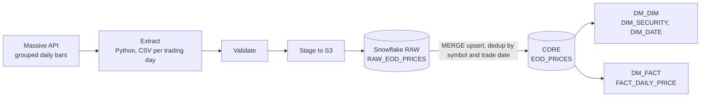

# Securities Pricing Data Pipeline

Automated end-of-day (EOD) US stock pricing pipeline built with **Apache Airflow, Python, SQL and Snowflake**. It downloads daily price bars, validates and stages them, and loads them into a Snowflake star schema using idempotent `MERGE` upserts, so reruns never create duplicates.

**Tech stack:** Apache Airflow 3.x · Python · SQL · Snowflake · AWS S3 · Docker (evaluated)

## Architecture



## Key features

- **Scheduled orchestration:** an Airflow DAG (`massive_eod_data_downloader_final_v2`) runs Monday to Friday at 21:05 UTC.
- **4-stage DAG:** extract → validate → stage to S3 → load to Snowflake, with retry logic and fail-fast validation at each stage.
- **Idempotent loads:** `MERGE` upserts keyed on symbol and trade date give exactly-once results across reruns.
- **Star schema:** two dimension tables (`DIM_SECURITY`, `DIM_DATE`) and one fact table (`FACT_DAILY_PRICE`).
- **Holiday and weekend handling:** a configurable 10-day lookback window resolves the correct trading date.
- **Config outside code:** API key and lookback days come from Airflow Variables, loaded from `.env`.
- **Scale:** 549,939+ curated rows loaded so far.

## Repository structure

```
.
├── 1_historical_load/        # one-time backfill of historical EOD prices
└── 2_daily_load/
    └── dags/
        ├── get_securities_data.py        # Airflow DAG
        └── lib/eod_data_downloader.py    # API download helper
```

## Design decisions

- **Docker Compose → native Airflow.** I first containerized Airflow with Docker Compose, then moved to a native Airflow 3.x install (WSL Ubuntu) because the container overhead was slowing the system down on my machine.
- **Layered Snowflake schemas** (RAW → CORE → DM_*) keep the raw landing data untouched and make the curated layer safe to rebuild.

## Setup

1. Install Airflow 3.x and the Python dependencies.
2. Create a Snowflake warehouse and the `RAW`, `CORE`, `DM_DIM` and `DM_FACT` schemas.
3. Set the Airflow Variables for the Massive API key and the lookback days.
4. Copy `2_daily_load/dags/` into your Airflow `dags` folder and enable the DAG.
5. Run `1_historical_load` once to backfill history.

## Possible next steps

- Add data-quality checks (row counts, price sanity rules) as a dedicated DAG task.
- Add alerting on DAG failures.
- Add an analytics layer or BI dashboard on top of `FACT_DAILY_PRICE`.

## Author

**Jaswanth Kumar Dowpati**: [LinkedIn](https://www.linkedin.com/in/jaswanth-dowpati-694336340) · [GitHub](https://github.com/jaswanthdowpati35-maker)
